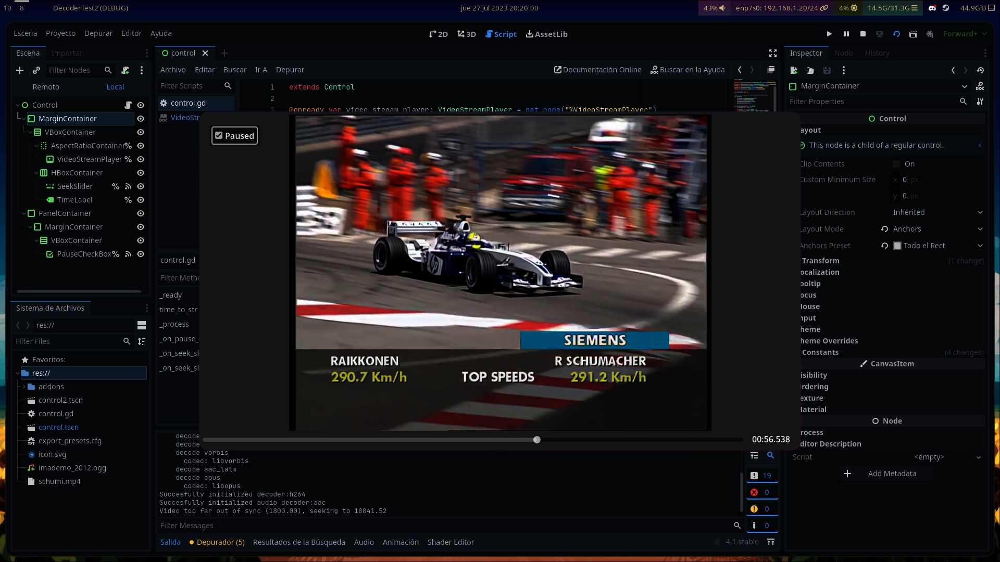

# EIRTeam.FFmpeg

Note: The version of FFmpeg shipped with EIRTeam.FFmpeg allows loading of videos using the patent-encumbered h264 codec, check with your local laws to see if software patents are recognized in your country.

GDExtension Video Decoder library for [Godot Engine](https://godotengine.org) >4.1,
using the [FFmpeg](https://ffmpeg.org) library.

# Building

Currently building ffmpeg from source is supported on Linux and macOS hosts. And ffmpeg libraries for Android can be cross compiled on both hosts.
Follow these steps:
* run `git submodule update --init` to fetch ffmpeg-kit sources.
* run `make bootstrap` to install building tools.
* run `make gdextension PLATFORM=linux` for Linux.
* run `make gdextension PLATFORM=macos` for macOS.
* run `make gdextension PLATFORM=android` for Android with default arch `arm64-v8a`.
* run `make gdextension PLATFORM=android TARGET_ARCH=arm-v7a` for Android with arch `arm-v7a`.

## Engine module FFmpeg builds

### Synchronizing background video to music

The engine module supports a per-playback music clock. Configure it **after
assigning the stream and before calling `play()`**:

```gdscript
video_player.stream = stream
var playback = video_player.get_stream_playback()
playback.set_playback_clock(func() -> float:
    return music_player.get_playback_position_nsec() / 1_000_000_000.0 + video_offset_seconds
)
video_player.play()
```

Return the authoritative, latency-corrected **video time in seconds**, including
the song's video offset. The callback runs on the playback/main thread, not on
the decoder or rendering threads. Do not apply pitch or engine time scale again:
the music position already includes playback speed.

External-clock mode collects decoded frames before choosing the newest frame
whose timestamp is due. Future frames wait, obsolete frames are discarded, and
large jumps/backward seeks reset decoding. Decode-ahead remains bounded while
music pauses. A seek also retains the closest preceding frame, so a frozen clock
between frame timestamps can display the correct image. Negative time holds the
initial image back; at EOF the last image is held and a subsequent backward
music-clock jump can restart playback. The owner must explicitly stop the video;
external-clock mode does not emit `finished` just because decoding reached EOF.

Embedded audio is discarded in this mode: the separate music player owns sound.
Calling `video_player.stop()` and setting an empty `Callable()` restores ordinary
standalone playback. Without a clock, the existing delta-driven mode remains.
`playback.get_playback_timing()` reports clock time, selected-frame timestamp,
selected-frame lateness, dropped frames, seeks, and local queue size. These are
**selection** timestamps, not measured monitor presentation times. A fixed
render/display offset may still need calibration; none is guessed automatically.

Catch-up is deliberately tolerant: transient lateness drops obsolete frames
without seeking, and small backward clock corrections (up to 50 ms) hold video
rather than restarting decoding. Game-thread stalls are distinguished from
clock jumps using elapsed wall time. Recovery seeks require more than **1.5 s**
of video lateness sustained for **1 s**, with at least **2 s** between recovery
seeks. This does not intentionally delay video by 1.5 s; it only controls when
decoding is restarted. Tune it with
`playback.set_clock_recovery_tolerance(seconds)` (0.1–30 s).
An in-progress seek is allowed to finish decoding its preroll without being
cancelled by lag recovery. Explicit music-clock discontinuities still seek immediately.

`get_playback_timing()` also reports `recovering`, `last_clock_seek_reason`,
`playing`, `seeking`, `decoder_state`, and `stop_reason`. Clock lateness alone never stops
external-clock playback. Actual Vulkan decoder/conversion faults remain fatal
and produce an explicit error, rather than silently switching to CPU decoding.

In Project Heartbeat, gameplay connects this through `VideoPlayerOffset.gd` to
Shinobu's song clock using the same compensation as chart timing. Editor preview
and older engines retain their existing behavior.

See [`tests/music_clock`](tests/music_clock/README.md) for regressions.

### FFmpeg configuration

Use `ffmpeg_path=/path/to/ffmpeg` for both software and GPU-capable builds.
The default `ffmpeg_gpu_decode=auto` compiles Vulkan Video support on Vulkan-enabled
x86_64 Linux/Windows builds when that prefix contains FFmpeg 9 or newer.
Use `ffmpeg_gpu_decode=no` to exclude it, or `yes` to require compatible headers.
The FFmpeg libraries must themselves include the H.264/HEVC Vulkan accelerators.
This engine-module option does not change the GDExtension build.
The engine dependency scripts use EIRTeam's `godot-9.0` packages and retain
the existing `buildeps/ffmpeg-master-latest-*-lgpl-godot` directory names.
Upstream `lgpl-shared-9.0` packages also work directly with `ffmpeg_path`,
but include substantially more unused codecs and dependencies.
To enable Vulkan Video queue creation, also set
`rendering/rendering_device/vulkan/video_decode` to `true` before the Vulkan
RenderingDevice is created. The setting requests Vulkan 1.3 and remains
disabled by default. Godot exposes a decode-only queue only when the driver
supports H.264/HEVC decode on a queue not shared with graphics or compute.
It also requires a private compute/transfer queue for FFmpeg frame pools.

By default this setting only probes the shared device; playback remains on
the existing software path. Experimental GPU playback additionally requires
`rendering/rendering_device/vulkan/video_decode_output=true`. Both settings
must be present before creating the RenderingDevice/decoder.

```ini
[rendering]
renderer/rendering_method="forward_plus"
rendering_device/vulkan/video_decode=true
rendering_device/vulkan/video_decode_output=true
```

The GPU output path retains Vulkan frames, attaches timeline waits and return
signals to the exact renderer command buffer, converts NV12/P010 planes with a
compute shader, and displays an RD-owned RGBA texture. External frames and
conversion resources stay alive through the frame fence. FFmpeg images use
concurrent sharing across the declared decode, auxiliary, and renderer queue
families, avoiding exclusive ownership transfers. Exclusive/external images
are rejected rather than imported with guessed ownership.

GPU output also requires the driver to decode into images that are distinct
from its reference pictures (`VK_VIDEO_DECODE_CAPABILITY_DPB_AND_OUTPUT_DISTINCT`
in use). Drivers that only support coinciding DPB/output images are rejected
with an error: returning such images to the decoder from a renderer
submission could create a decode/render queue cycle. RADV on RDNA3 uses
distinct images; other drivers are untested.

This initial path supports H.264/HEVC, progressive 8-bit or 10-bit SDR 4:2:0, BT.601/BT.709,
and full/limited range. It rejects HDR/BT.2020, unsupported color matrices,
cropped/interlaced frames, unsupported image layouts/formats, and unavailable Vulkan
devices. GPU output never downloads or converts pixel data on the CPU and
never falls back to software decoding. Stream-info software probing is also
disabled in this mode, so containers must supply sufficient codec metadata.
GDExtension behavior is unchanged.

For reproducible hardware-frame-only and GPU playback tests, see
[`tests/vulkan_decode`](tests/vulkan_decode/README.md). Build it with
`ffmpeg_gpu_tests=yes` in addition to the GPU module options.

# Documentation

The official documentation can be found [here](https://eirteam-docs.readthedocs.io/en/latest/documentation/ffmpeg/ffmpeg_getting_started.html).

# Supporting development

You can also support EIRTeam by donating on [Patreon] or purchasing [Project Heartbeat](https://store.steampowered.com/app/1216230/Project_Heartbeat/).

<a href="https://www.patreon.com/EIRTeam" target="_blank">
  
</a>

[Patreon]: https://www.patreon.com/EIRTeam
